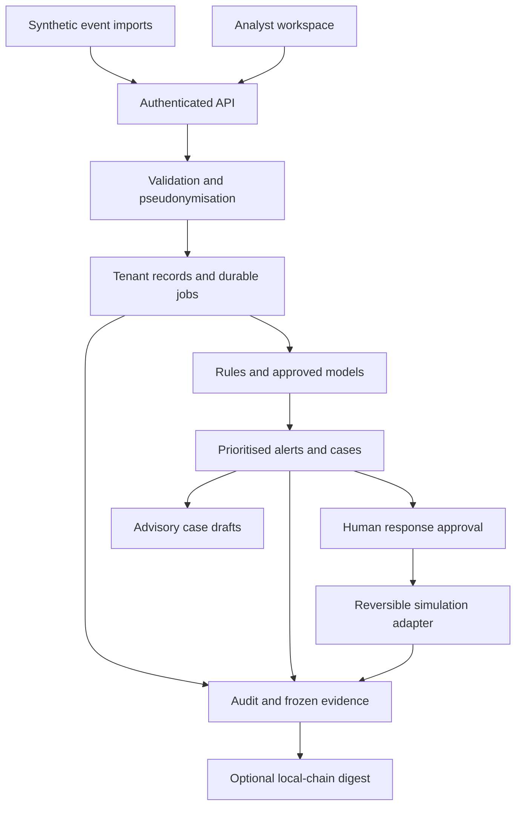

# SecureFI

### Security operations, detection engineering and evidence management

**Created and maintained by [Sarowar Raaja Manikandan](https://github.com/Sarowarraaja-39)**  
[GitHub](https://github.com/Sarowarraaja-39) · [LinkedIn](https://www.linkedin.com/in/sarowar-raaja-m/) · Version 2.1.0

I built SecureFI to bring the investigation workflow into one place: receive a security observation, understand its risk, investigate it, review a response and preserve the evidence behind the decision.

The application combines SIEM-style event processing, detection rules, asset context, case management, SOAR-style approval workflows, AI security monitoring and Web3 evidence verification. My focus is on engineering decisions that an analyst or reviewer can inspect: explicit detection logic, explainable priority scores, attributable actions and reproducible tests.

SecureFI runs locally with Python and SQLite. It also includes optional service adapters and cloud deployment assets. The current release accepts synthetic telemetry and uses simulated response actions, so the complete workflow can be demonstrated without customer data, production credentials or real cryptocurrency.


_My local SecureFI 2.1 workspace after loading the demonstration data: 55 events, 49 active alerts, eight alerts with priority scores of at least 80, and no open cases. These are fixture results, not live incidents or a detection-accuracy benchmark._

**Explore:** [Run locally](#run-locally) · [Application walkthrough](#application-walkthrough) · [Architecture](#architecture) · [Security controls](#security-controls) · [Validation](#validation) · [Roadmap](#roadmap)

## Why I built it

An alert becomes useful when it has enough context to support a decision. Its severity alone does not explain which service matters, who owns the investigation, what evidence supports the finding or whether a proposed response was approved.

I designed SecureFI around that chain of responsibility. The inbox links a detection to its source observations. Asset ownership changes its priority. A case records the investigation. A separate identity approves a bounded response. An evidence report captures the resulting records and their integrity checkpoint.

The repository is my practical security engineering portfolio, with source code, tests and operating instructions that let someone else reproduce the workflow.

## Run locally

**Requirements:** Python **3.11 or newer**. The default application has no third-party Python dependencies and needs no cloud account, API key or frontend build.

From the folder containing `start.py`, run:

```bash
python3 --version
python3 start.py --demo
```

Open **http://127.0.0.1:8765** and sign in with the **analyst token** printed in the terminal.

On Windows, use `py -3 start.py --demo` with a supported Python installation. If your system exposes Python as `python`, that command also works. On macOS, use `python3`; `zsh: command not found: python` means the shorter command is unavailable.

On the first start, the application prints a random token for each role. Save these privately: later starts do not display them again. The `data/` directory contains the workspace database and access configuration and is excluded from Git.

| Task                               | Command                               |
| ---------------------------------- | ------------------------------------- |
| Start an empty workspace           | `python3 start.py`                    |
| Start with demonstration telemetry | `python3 start.py --demo`             |
| Use another local port             | `python3 start.py --demo --port 8766` |
| Process pending durable jobs       | `python3 -m securefi app worker`      |
| Stop the server                    | Press `Ctrl+C` in its terminal        |

Loading the same demonstration events again does not duplicate them. To review a response, lock the workspace and sign in as the separate approver. [User guide](docs/USER_GUIDE.md) covers additional identities, case transitions and recovery of workspace access.

## Application walkthrough

The ten views follow an operational sequence: understand exposure, triage alerts, add context, investigate, review specialist findings and preserve evidence. The screenshots below are from my local run of this release. They show the state at capture time; an empty queue or an unconfigured integration is labelled accordingly.

### 1. Overview: decide where to start

The opening dashboard shows active alerts, high-priority exposure, open cases and processed events. A priority queue brings the highest scores forward, while the source breakdown shows where those observations originated.

The overview screenshot above shows the seeded starting position. No case has been opened yet. Accepting risk, resolving an alert or allowing an acceptance to expire changes the active-exposure totals according to the recorded disposition.

### 2. Alert inbox: investigate the observation


The inbox combines detection name, rule ID, asset, severity, priority score, owner and status. Search works across detection, asset, owner and rule ID; filters narrow the queue by source, severity and disposition.

Opening an alert exposes its source event references, recommended checks and risk-factor breakdown. An analyst can record triage, assign an owner, classify a false positive, accept risk temporarily or resolve the alert with verification. A new supporting observation can reopen a resolved alert; replaying the original event cannot.

The screenshot shows several critical observations at **89/100** and still unassigned. That score is a transparent priority heuristic:

```text
score = min(100, severity weight + asset criticality factor
                  + internet exposure factor + exploitation factor)
```

Severity contributes 15, 35, 60 or 80 for low, medium, high or critical. Asset criticality contributes `(criticality − 1) × 3`; internet exposure adds 10; a supplied known-exploited flag adds 15. Rule confidence is recorded separately. The score is not a probability of compromise, and the application does not fetch an external exploitation feed automatically.

### 3. Cases & response: make decisions accountable


_This screenshot shows the initial empty investigation register and response queue. It demonstrates the entry point, rather than a completed incident response._

Opening a case from an alert creates an incident reference, links its source alert and records the initial note. Subsequent updates retain the owner, actor, timestamp, investigation timeline, status and verification text. An existing active case is reused for the same alert. Resolving or closing a case requires verification and updates the linked alert's status.

SecureFI includes **15 response playbooks** covering identity, privilege, storage, logging, endpoints, networks, API abuse, Kubernetes, images, key rotation, exfiltration, AI investigation, model rollback and wallet review.

The response sequence is enforced by the application:

1. An authorised analyst requests a playbook from a case.
2. A different approving identity records approval or rejection.
3. Approval must still be valid when execution starts; requests expire after one hour.
4. Execution updates a synthetic resource and records the simulated step results.
5. The exact saved before-state can be restored.

Repeated execution of a completed run is idempotent. Notifications remain within the workspace; no email, Slack or external webhook messages are sent. The adapter does not isolate a real host, revoke a real identity session or change a cloud account.

### 4. Asset inventory: add business context


The inventory discovers asset names from event observations. Registering an asset adds an accountable owner, environment, criticality and exposure assessment. That context changes existing alert priorities and enriches future processing, including queued events, without rewriting previously stored observations.

The screenshot shows discovered assets such as `lab-cloud`, `lab-endpoint` and `lab-kubernetes`, with **observed** context and **Unassigned** owners. It represents discovery before registration, making the remaining ownership work visible.

### 5. Detection library: inspect the logic


The library contains **49 versioned detections** across identity, cloud, Kubernetes, endpoint, network, application, AI and Web3 observations.

Examples visible here include failed sign-in bursts, impossible travel, privileged sign-in without MFA and unapproved privilege grants. Each definition carries source requirements, detection conditions or correlation logic, severity, confidence, response guidance, control references and false-positive context.

ATT&CK relationships are qualified. A direct behavioural match, a behavioural indicator and a control-gap analogy do not represent the same level of evidence. This keeps posture observations from being presented as confirmed attacker activity.

The engine supports field conditions, count windows, event sequences and travel comparisons. Related hits are grouped by rule, principal, asset and a fixed five-minute window. Individual definitions live in [detections/rules](detections/rules); the packaged runtime catalogue is [securefi/platform/catalogue.json](securefi/platform/catalogue.json).

### 6. Cloud & Kubernetes: review configuration and workload exposure


This view brings imported cloud and Kubernetes findings together. The screenshot includes cluster-admin bindings, host runtime-socket mounts, anonymous secrets access, unsigned image admission and deleted cloud audit evidence.

These observations help demonstrate configuration review, least-privilege analysis and workload-security triage. They are evaluated from supplied telemetry: the current application does not deploy a sensor, connect to a cloud account or scan a cluster automatically.

The repository separately includes Terraform modules, Kubernetes manifests, a Helm chart and policy tests for deployment engineering. Those assets require environment-specific configuration and validation.

### 7. AI security & models: monitor AI and govern its use


SecureFI separates three AI-related capabilities so their purpose and trust boundaries remain clear.

| Capability               | Implemented behaviour                                                                                                                                                          |
| ------------------------ | ------------------------------------------------------------------------------------------------------------------------------------------------------------------------------ |
| AI threat monitoring     | Indicators for prompt injection, jailbreak attempts, sensitive output, disallowed tools, external exfiltration URLs, shadow AI, insecure deployment, drift and model tampering |
| Behavioural detection    | Supervised logistic regression, a normal-only distance baseline and a hybrid decision; holdout evaluation and per-feature score contributions                                  |
| Investigation assistance | Optional local Ollama drafts linked to a case, with strict output validation, provenance and a human review record                                                             |

The screenshot demonstrates AI **telemetry findings**, including a model artifact digest mismatch and an agent requesting a disallowed tool. It does not establish that an LLM is connected or that a behavioural model has been promoted.

Model training uses a seeded synthetic dataset and chronological training, validation and test partitions. Features include transformed bytes, request counts, target counts, duration, token counts and privilege state. Artifacts are bounded JSON with SHA-256 integrity records. A separate identity must approve activation; an earlier verified version can be re-promoted for rollback. Drift indicators and comparison functions support investigation, rather than automatic retraining.

The investigation assistant receives a minimised case context, has no execution tools and cannot approve a response, change a score or close a case. When no model is enabled, or a model response fails validation, the saved draft explicitly identifies its deterministic fallback. Approving a draft retains it for reference; it does not execute its suggestions.

See [Model card](ml/MODEL_CARD.md) and [Integration setup](docs/INTEGRATIONS.md) for configuration, evaluation and limitations.

### 8. Web3 monitoring: distinguish transaction indicators from evidence integrity


The Web3 monitoring view evaluates synthetic wallet and contract observations. The screenshot shows all four supplied Web3 detection cases: a flagged recipient, rapid approval followed by transfer, an unlimited token approval and an unexpected privileged contract event.

A separate optional Solidity registry records the hash of a frozen evidence document on development chain **31337**. Only the digest goes on-chain; the report contents remain off-chain. The client checks the chain ID and expected deployed contract code, and the contract restricts new records to its owner.

These are separate workflows: a suspicious wallet pattern is an observation to investigate, while an evidence digest is an integrity reference. Neither establishes the safety of a real wallet. Public-chain collectors, real funds, real financial transactions and production wallet keys are excluded.

### 9. Controls & evidence: preserve a reviewable record


A generated report freezes alerts, cases, asset context, playbook records, assistant-draft provenance, the control register and an audit checkpoint. Its canonical JSON document has a SHA-256 digest. Later workspace changes do not rewrite that snapshot.

The screenshot shows a **local snapshot** with JSON download and document-verification controls. The development registry is explicitly **Not configured**, so this screenshot does not claim an on-chain attestation.

The current application contains **12 control groups** with candidate relationships to **ISO 27001, SOC 2, GDPR, DORA, NIS2 and CIS Controls**, plus finding-to-control mappings. They help organise technical evidence for review. Applicability, operating effectiveness and any regulatory conclusion still require human assessment.

Audit verification checks the retained hash-linked records. Independently retained checkpoints are needed to detect suffix deletion or complete rewriting. An optional local-chain digest match establishes content identity on the queried chain; it does not prove evidence truth or certify compliance.

### 10. Activity log: trace what happened


The activity log records the actor, timestamp, action and supporting details for workspace changes. The interface displays the latest 150 tenant audit entries, while integrity verification examines the full retained chain.

This capture shows a useful reproducibility check: the initial load accepted **55** events, the next import recorded **55 duplicates** and accepted none, and a later action generated an evidence report. The green verification result refers to the three retained audit entries at that point. It does not mean the environment is free of threats.

## Architecture

I chose a modular monolith so the complete workflow remains practical to run, test and maintain. The local HTTP server and optional FastAPI service use the same domain rules. SQLite provides the default store; PostgreSQL is an optional integration profile.



Event validation completes before batch mutation. Duplicate observations are skipped; reusing an ID with changed content rejects the transaction. Queued mode stores durable SQL jobs. The optional RabbitMQ bridge provides wake-up notifications, with SQL job state remaining authoritative.

The internal event envelope is **OCSF-inspired**, with custom AI and Web3 classes. It is not a claim of full OCSF conformance. The optional OpenSearch helper creates a tenant-scoped search projection; it is not an automatically connected dashboard search backend.

[Architecture](docs/ARCHITECTURE.md) and [API reference](docs/API.md) explain component boundaries and endpoints.

## Security controls

| Boundary            | Current implementation                                                                                             |
| ------------------- | ------------------------------------------------------------------------------------------------------------------ |
| Identity            | Random bearer tokens stored as hashes; each token selects a role, tenant and identity                              |
| Authorisation       | Server-side role checks and tenant-derived lookups; cloud role limited to cloud/Kubernetes operations              |
| Response governance | Requester cannot self-approve, including when using an admin role; approval expiry and before-state recovery       |
| Input handling      | Allowlisted event fields, finite scalar checks, timezone validation, 2 MiB imports and 500-event batches           |
| Data minimisation   | Tenant-keyed HMAC identifiers for principals/IPs; raw prompt and output text replaced by hashes and coarse signals |
| Browser boundary    | HTML escaping, content policy, host/origin checks and session-scoped token storage                                 |
| Local integrations  | Literal loopback endpoints, no redirect following or inherited proxies; chain 31337 and contract checks            |
| Model governance    | JSON artifacts, integrity verification, independent promotion and explicit provider/fallback provenance            |
| Audit and evidence  | Attributable decisions, linked audit hashes, frozen document digests and optional development-chain lookup         |

Access is intentionally separated:

| Role       | Main responsibilities                                                                                    |
| ---------- | -------------------------------------------------------------------------------------------------------- |
| Analyst    | Import, triage, assets, cases, response requests, drafts and evidence                                    |
| Approver   | Independent response approval, authorised simulation execution, model activation and registry deployment |
| Cloud      | Cloud/Kubernetes observations, cases and scoped response operations                                      |
| Compliance | Evidence generation, audit verification and evidence-hash operations                                     |
| Executive  | Aggregate metrics and reference catalogues; no event, alert or case payloads                             |
| Ingestor   | Event submission and durable-job processing; no investigation payloads                                   |
| Admin      | Workspace administration; requester/approver separation still applies                                    |

The default service binds to loopback. SSO/MFA, managed credential lifecycle, shared-service isolation and hardened external exposure remain follow-up work. [Security policy](SECURITY.md) and [Threat model](docs/THREAT_MODEL.md) describe the current boundary.

## Technology and delivery

| Area                 | Implementation / status                                                                              |
| -------------------- | ---------------------------------------------------------------------------------------------------- |
| Interface            | HTML, CSS and JavaScript; responsive views without a frontend build step                             |
| Backend              | Python standard-library local server; optional FastAPI/ASGI transport                                |
| Persistence          | SQLite by default; optional PostgreSQL adapter                                                       |
| Queue and search     | Durable SQL jobs; optional RabbitMQ bridge and TLS OpenSearch projection                             |
| Models and assistant | Python behavioural baselines; optional local Ollama adapter                                          |
| Blockchain           | Solidity registry, Hardhat development node, compiled artifact and bounded JSON-RPC client           |
| Infrastructure       | Docker/Compose, Kubernetes/Helm, Terraform network and evidence-storage modules                      |
| Delivery assurance   | GitHub Actions, Bandit, pip-audit, detect-secrets, Trivy scan/SBOM jobs and OPA policy tests         |
| Signing              | Manual Cosign workflow for an existing repository-owned image digest; requires release configuration |

The delivery pipeline defines test, SAST, dependency, secret, IaC, container and policy gates. It also defines CycloneDX SBOM generation and contract/browser checks. Definitions are supplied as code; their execution status is reported separately below. Image signing does not automatically build or publish an image.

The earlier findings workbench retains SARIF, CycloneDX and configuration-import adapters in a separate database. Those compatibility tools are not silently merged into the main event store.

## Repository guide

| Path                                                          | Purpose                                                                            |
| ------------------------------------------------------------- | ---------------------------------------------------------------------------------- |
| [securefi/platform](securefi/platform)                        | Current application workflows, detection engine, models, storage and web interface |
| [securefi](securefi)                                          | Shared adapters, local integrations and compatibility findings workbench           |
| [services](services)                                          | Optional ASGI service, queue bridge and search projection                          |
| [detections](detections) / [playbooks](playbooks)             | Reviewable detection and response definitions                                      |
| [compliance](compliance) / [schemas](schemas)                 | Candidate control register, finding mappings and event/storage contracts           |
| [examples](examples) / [datasets](datasets)                   | Synthetic import examples and reproducible fixtures                                |
| [ml](ml)                                                      | Model card; training implementation lives in `securefi/platform/ml.py`             |
| [blockchain](blockchain)                                      | Solidity source, compiler script and local-chain configuration                     |
| [infra/terraform](infra/terraform) / [deploy](deploy)         | Infrastructure modules, Compose, Kubernetes and Helm                               |
| [policies](policies) / [.github/workflows](.github/workflows) | Policy checks and delivery/security jobs                                           |
| [tests](tests) / [scripts](scripts)                           | Regression, boundary, browser, chain, evaluation and validation checks             |
| [docs](docs)                                                  | User guide, architecture, API, operations and screenshots                          |

## Validation

The release validation record dated **21 October 2026** documents **124 passing Python tests**, a real Chromium workflow check, FastAPI boundary checks and actual transactions against a local development EVM.

| Check            | Recorded result                                                                                                                                             |
| ---------------- | ----------------------------------------------------------------------------------------------------------------------------------------------------------- |
| Core suite       | 124 tests passed                                                                                                                                            |
| Browser workflow | Ten views, triage, assets, cases, draft review, independent approval, simulated execution/restore, JSONL import, evidence download and mobile layout passed |
| ASGI integration | Event ingestion and role/tenant/origin boundaries passed                                                                                                    |
| Local EVM        | Deployment, evidence recording/lookup, duplicate handling, tamper rejection, contract restrictions and reset detection passed                               |
| Rule fixtures    | All 49 catalogue rules exercised by 55 synthetic events                                                                                                     |
| Static assets    | JSON/schema, deployment YAML and HCL syntax parsing passed                                                                                                  |
| Security checks  | No medium/high Bandit findings; point-in-time dependency and unsuppressed-secret checks passed                                                              |

Reproduce the core checks:

```bash
python3 -m unittest discover -s tests -v
python3 scripts/evaluate.py
```

Browser checks require the optional Node dependencies:

```bash
npm ci
npx playwright install chromium
npm run test:browser
```

The synthetic model comparison uses 1,800 generated rows with chronological partitions. On the documented seed, logistic F1 was **0.7521**, distance-baseline F1 **0.5773**, and hybrid F1 **0.5376**. The hybrid reduced false positives while also reducing recall; it was not uniformly better. These results describe the supplied generator, not measured effectiveness on financial production traffic.

Docker builds/scans, Terraform provider validation/apply, Helm/OPA execution, Kubernetes deployment and the PostgreSQL/RabbitMQ/OpenSearch runtime were not exercised end to end in that release environment. The model-service contract was tested with controlled responses; downloaded LLM weights were not executed. Full commands, confusion counts and limits are in [TESTING.md](TESTING.md).

## Demonstrate the complete workflow

The screenshots show the starting state. To demonstrate what happens next:

1. Load the sample data and search the inbox for `SF-029`.
2. Inspect its source observation and score factors, then record triage and ownership.
3. Open a case, add an investigation update and review an assistant draft.
4. Request the suggested playbook and show that execution is blocked before approval.
5. Sign in as a separate approver, record a decision and execute the simulation.
6. Restore its before-state and inspect the stored outcome.
7. Generate a report, download its JSON and verify the audit chain.
8. If the optional local chain is enabled, record the report digest and verify it. Altering the exported document must fail its digest comparison.

This demonstrates the relationship between detection, investigation, authorisation, recovery and evidence rather than treating each dashboard as an isolated feature.

## Roadmap

My next priorities are managed identity and token lifecycle, paginated queries, bounded correlation state, operational readiness checks and repeatable restore drills. Further integration work includes read-only telemetry collectors and independently validated container/cloud profiles.

Real response connectors would need narrowly scoped credentials, dry-run policy, external-action idempotency and compensating recovery. Additional model work needs independent datasets and stated acceptance criteria before any operational adaptation.

These are planned improvements. The current release does not provide guaranteed breach prevention, autonomous AI containment, full regulatory certification or production blockchain monitoring.

## Documentation and contribution

Start with the [User guide](docs/USER_GUIDE.md). Use [Integration setup](docs/INTEGRATIONS.md) for optional Ollama and chain configuration, [Operations](docs/OPERATIONS.md) for deployment and recovery, and [GitHub upload instructions](docs/GITHUB.md) to publish your copy.

Issues and focused pull requests are welcome. Include a minimal synthetic reproduction, expected behaviour and relevant validation. Read [CONTRIBUTING.md](CONTRIBUTING.md); report security issues through the process in [SECURITY.md](SECURITY.md).

## Creator

**Sarowar Raaja Manikandan** — creator and project maintainer.

SecureFI is part of my work in security operations, detection engineering, cloud security and security automation. I use this project to make my implementation choices, investigation workflow and validation evidence available for technical review.

[GitHub: Sarowarraaja-39](https://github.com/Sarowarraaja-39) · [LinkedIn](https://www.linkedin.com/in/sarowar-raaja-m/)

Released under the [MIT licence](LICENSE).
