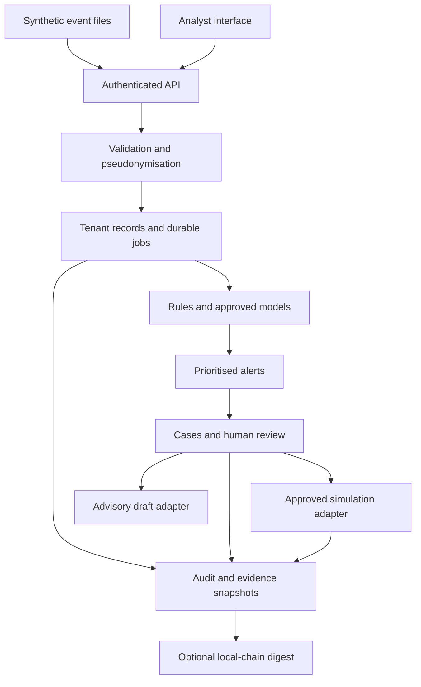

# Architecture

SecureFI uses a modular monolith so an individual maintainer can run, inspect and test the complete workflow. A shared domain layer serves the local HTTP application and optional ASGI transport. SQLite is the supported zero-install profile; optional adapters provide a path to sandbox infrastructure without changing domain decisions.

## Components and contracts

| Component | Responsibilities | Main implementation |
| --- | --- | --- |
| Transport | Bearer auth, host/origin validation, bounded JSON input, static UI | `platform/server.py`, `services/asgi.py` |
| Product workflows | Triage, asset context, case timelines, frozen reports, scoped state | `platform/product.py` |
| Core operations | Event transaction, rule execution, jobs, approvals, simulated response | `platform/app.py` |
| Normalisation | Supported sources/fields, time and type checks, tenant HMACs, prompt/output signal extraction | `platform/normalise.py` |
| Detection | Conditions, correlation, ATT&CK relationships, risk factor breakdown | `platform/detection.py` |
| Models | Chronological splits, threshold selection, evaluation, JSON artifacts, approval and drift functions | `platform/ml.py` |
| Assistant | Minimal case context, optional loopback model request, strict output shape and review | `platform/assistant.py` |
| Evidence ledger | Frozen digest validation, verified contract, deployment/anchor/lookup | `platform/evidence_ledger.py`, `securefi/blockchain.py` |
| Persistence | Tenant-scoped document records, transactional jobs and audit hashes | `platform/store.py` |

`securefi/platform/rules.json`, `playbooks.json` and `controls.json` are packaged runtime catalogues. Their repository counterparts provide reviewable individual definitions. Rule-evaluation checks detect missing fixture coverage; review changes to both catalogue representations together.

## Data flow and transaction boundaries

The API derives tenant and identity from a hashed opaque token. Event validation completes before the batch transaction. Each event has an immutable source ID within its tenant. Duplicate content is skipped; an ID collision rejects the batch. Registered asset context affects priority without rewriting an already stored source observation.

Immediate processing evaluates tenant history and updates rule/principal/asset/five-minute alert groups inside the transaction. Queued processing first records a pending SQL job; a worker evaluates it and changes its state in a tenant write transaction. Job state is the authority for deduplication. The optional RabbitMQ bridge provides durable wake-up notifications, rather than a second event database.

Cases reference alerts; alerts reference evidence event IDs. A response request references a case and versioned playbook. Independent approval is a separate transition. Execution and its simulated resource state change share the SQL transaction. External real-world action connectors are deliberately absent, avoiding a false claim of atomic external containment.

Reports contain a frozen document plus its digest. Optional chain metadata lives outside that document so adding an attestation does not change the digest. A database or network failure after an on-chain transaction may require retry; the adapter looks up an existing digest and handles that retry without inventing another record.

## Storage model

The operational store uses `records(tenant, kind, id, payload)`, `jobs`, `audit` and PostgreSQL tenant locks. Entity types include event, alert, case, run, resource, notification, model, evidence, asset, draft and registry. PostgreSQL JSON payload indexes and the OpenSearch projection are described in `schemas/`; SQL remains the source of truth.

This is an application-enforced multi-tenant design. It does not implement PostgreSQL row-level security or one database per customer. Tenant keys are explicit on every domain lookup, and tests exercise cross-tenant access. The default token file and all-tenant service process are appropriate for a controlled workspace, not a shared commercial service.

## Trust boundaries

- The browser receives permitted data only and renders imported strings with HTML escaping. Tokens remain in session storage until lock or tab closure.
- The local server binds to loopback. Host/origin checks and a restrictive content policy reduce browser-origin abuse. The local rate limiter is in memory, per identity.
- Event fields are untrusted even after validation. Principals and IPs become tenant-keyed HMAC identifiers. Raw prompts and outputs become hashes and coarse indicators.
- The assistant accepts only a bounded, schema-checked response with the original case ID. It gets no tools, credentials, raw prompts, notes, event payloads, asset names or owner identities.
- Optional model and chain endpoints must use literal loopback addresses. The chain client checks chain 31337 and compiled contract runtime identity. Development accounts are disposable.
- A database administrator can rewrite data. Audit hashes need independent checkpoints, and a local blockchain controlled by the same operator is not an independent trust service.

## Deployment and failure behaviour

The local HTTP server and SQLite profile target a single private workstation. Optional FastAPI, PostgreSQL and RabbitMQ containers are defined in Compose. Kubernetes uses a service account without mounted API credentials, non-root execution, read-only root filesystem, dropped capabilities, resource limits and separate secrets. Network policies require a compatible CNI and deployment-specific review.

Recovery starts from a consistent database backup and matching token/pseudonym configuration. Preserve the key to retain stable correlation. Failed SQL mutations roll back. Jobs retry up to three attempts before a dead state. The broker bridge must be restarted after connection failure; it does not implement its own reconnection manager. Chain state is not restored by a SQL backup.

Current performance is limited by full tenant-history scans, document lists and synchronous detection. The UI displays at most 500 events, but alerts/cases/reports have no cursor pagination. Add partitioned/indexed events, bounded correlation state, query pagination, observability and independent tenant workers before scaling. Health checks currently show process availability, not end-to-end service readiness.
